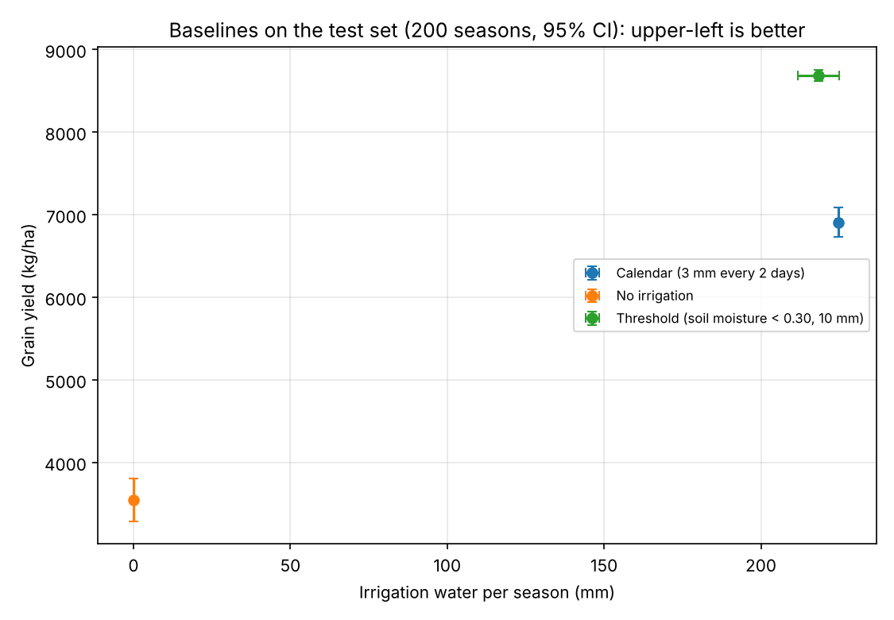

# 🌱 Smart Irrigation Agent: Deep Learning + Reinforcement Learning

An agent that decides **how much to irrigate each day (0, 5, 10, 15 or 20 mm)** over a maize season in the [gym-DSSAT](https://github.com/rgautron/gym-dssat-pdi) crop simulator, using a soil-moisture forecaster and an RL policy, with a short natural-language explanation of each decision.

> **Status: in progress (Week 2 of 7).** Simulator, evaluation harness and tuned baselines are done and validated. Forecaster and RL agent training are next. No RL result is claimed yet.



## 🎯 Problem
Agriculture uses ~70% of freshwater withdrawals. Over-irrigation wastes water, under-irrigation lowers yield. The goal is a data-driven policy that adapts to weather and soil state, **compared honestly** against well-tuned simple strategies.

## 🧩 Approach
| Module | Method | Role |
|---|---|---|
| **1. Forecasting** (supervised DL) | LSTM / GRU / Transformer (PyTorch) vs Random Forest / XGBoost | From the last 14 days, predict soil moisture for D+1…D+7 |
| **2. Decision** (RL) | PPO vs DQN (Stable-Baselines3), with/without forecaster input | Learn an irrigation policy; reward = yield − water cost − water stress |
| **3. Explanation** | Template + optional LLM rewording | One sentence per decision; the LLM never decides |

**Protocol**: all methods run on the same weather seasons; baselines are tuned on validation seeds and reported on held-out test seeds with 95% confidence intervals; planned stress tests: drought, heat wave, noisy sensors.

## 📊 Results so far: tuned baselines (test set, 200 seasons)
| Policy | Yield (kg/ha) | Irrigation (mm) | Stress days | Mean reward |
|---|---|---|---|---|
| No irrigation | 3,547 ± 1,861 | 0 | 8.5 | 2.96 |
| Calendar (3 mm every 2 days) | 6,909 ± 1,276 | 225 | 0.8 | 5.78 |
| **Threshold (soil moisture < 0.30, 10 mm)** | **8,690 ± 484** | **218** | **0.0** | **7.79** |

(± = standard deviation across seasons.) **The RL agent must beat a mean reward of 7.79** to be considered better than the best baseline.

| Forecaster (D+1…D+7) | RMSE | R² |
|---|---|---|
| LSTM / GRU / Transformer / Random Forest | to do | to do |

## ⚙️ Installation
gym-DSSAT runs in Docker. Build the project image, then work inside it:
```bash
git clone https://github.com/marwen-benhajkacem/smart-irrigation-dl-rl.git
cd smart-irrigation-dl-rl
docker build -f Dockerfile.project -t irrigation-agent .
```
Deep Learning training can run on Google Colab (GPU): `pip install -r requirements_colab.txt`.

## ▶️ Usage (inside the container)
```bash
python scripts/00_discover_env.py        # list gym-DSSAT variables
python scripts/02_calibrate_soil.py      # soil moisture bounds
python scripts/01_run_one_season.py      # one season, baselines plot
python -m src.tune_baselines             # tune baselines on validation seeds
python -m src.evaluate --split test --methods best
```
All parameters (seeds, actions, reward, sensors) are in `src/config.py`.

## 📁 Structure
```
src/          config, env wrapper, policies, evaluation, forecaster, RL training, explanations
scripts/      environment discovery and first runs
references/   versioned reference outputs (tuned baselines, test evaluation, soil bounds)
config/       gym-DSSAT environment config used by the Docker image
tests/        toy simulator + smoke test (code testing only, never for reported results)
results/      figures
```

## 🔮 Roadmap
- [x] Environment discovery, soil calibration, evaluation harness
- [x] Baselines tuned and evaluated on test seeds
- [ ] Dataset generation + forecasters (LSTM/GRU/Transformer vs RF/XGB)
- [ ] PPO / DQN training, with and without forecaster
- [ ] Stress tests, ERA5-Land validation, explanations

## 👥 Authors
Marwen Ben Haj Kacem · Farah Baaziz, Master's in Data Science, ISIMA.
